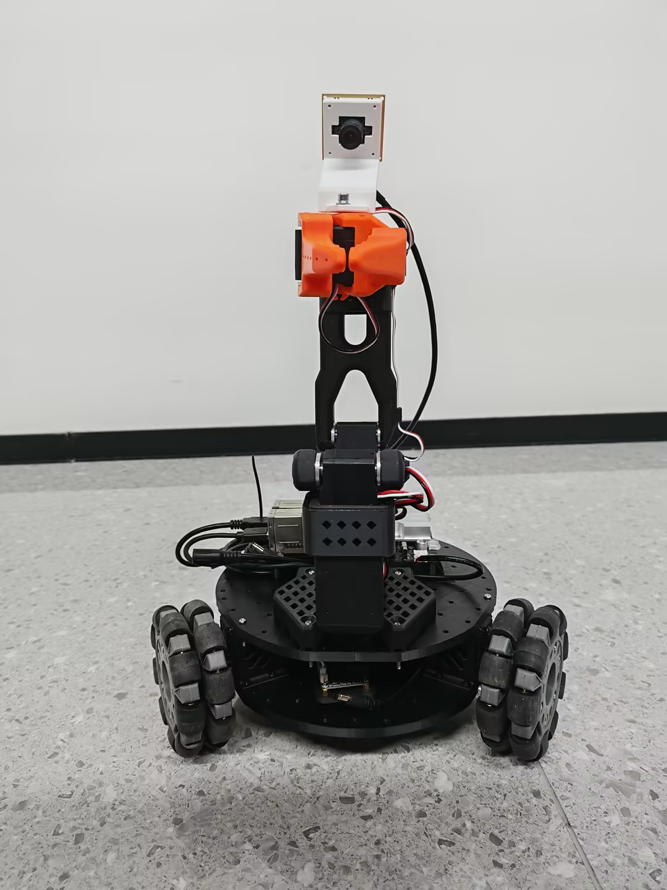

# LeKiwi_A1 — Mobile Manipulator (LeRobot)

> LeKiwi is an open-source **mobile manipulator robot**: a 3-omniwheel differential chassis carrying a 6-DOF robotic arm with a soft gripper, driven by 9 FEETECH STS3215 bus servos. It runs the [LeRobot](https://github.com/huggingface/lerobot) software stack on a **RhinoPi A1** (ARM64) board and is teleoperated from a Windows PC, either with a leader arm (SO100) or pure keyboard control.



---

## Table of Contents

- [What's in This Repository](#whats-in-this-repository)
- [Hardware Overview](#hardware-overview)
- [Repository Structure](#repository-structure)
- [Quick Start — 3 Stages](#quick-start--3-stages)
  - [T1 · Board Side: Setup the Host](#t1--board-side-setup-the-host)
  - [T2 · PC Side: Environment + Keyboard Teleop](#t2--pc-side-environment--keyboard-teleop)
  - [T3 · Leader Arm: Calibrate, Zero-Align & Teleoperate](#t3--leader-arm-calibrate-zero-align--teleoperate)
- [Daily Command Cheat Sheet](#daily-command-cheat-sheet)
- [Restarting After Shutdown](#restarting-after-shutdown)
- [Configuration (config/env)](#configuration-configenv)
- [Troubleshooting](#troubleshooting)
- [Tested Versions & Limitations](#tested-versions--limitations)
- [License](#license)

---

## What's in This Repository

This repository assembles everything needed to build and run a LeKiwi robot:

| Area | Contents |
| --- | --- |
| **Hardware** | [BOM](BOM.md), [3D-printable parts](3D_Printing_Models/), [assembly guide](Assembly_Steps_and_Structure_Diagram/Assembly_Steps.md), [wiring diagram](Wiring_Diagram/Wiring_diagram.png), [servo ID setup](Set_Servo_ID/Set_Servo_ID.md), joint-name reference ([URDF_JOINT_NAMES.md](URDF_JOINT_NAMES.md)) |
| **Software** | Deployment/teloperation scripts for the board host and the PC control end (see [Code_Resources/](Code_Resources/README.md)) |

> The software part ([`Code_Resources/`](Code_Resources/README.md)) is derived from the upstream
> [`lekiwi-Rhinopi-A1`](https://github.com/XIZAINB/lekiwi-Rhinopi-A1) deployment repo: one-command environment setup,
> host control, calibration and zero-alignment helpers, and keyboard-only teleoperation.
> It does **not** fork or modify the lerobot source — `upstream/lerobot-main/` is a read-only snapshot for reference.

---

## Hardware Overview

- **Compute**: RhinoPi A1 (APLUX, ARM64 / AidLux or Ubuntu 24.04.3) — runs the lerobot host.
- **Base**: 3× 4-inch (100 mm) omniwheels, each driven by an STS3215 servo (IDs **7–9**).
- **Arm**: 6-DOF arm with soft gripper, 6× STS3215 servos (IDs **1–6**), plus 2× servo driver boards (12 V external power).
- **Power**: 2× 12 V 5 A Li-ion battery packs (one for base + arm, one for the RhinoPi A1; no step-down regulator needed).
- **Sense**: USB wrist camera (optional, disabled by default), leader arm SO100 for teleoperation.
- **Control end**: Windows 10/11 PC (PowerShell 5.1) — teleoperation client.

Full part list with purchase links: [BOM.md](BOM.md).
3D-printed STL parts: [3D_Printing_Models/](3D_Printing_Models/).
Detailed assembly: [Assembly_Steps_and_Structure_Diagram/Assembly_Steps.md](Assembly_Steps_and_Structure_Diagram/Assembly_Steps.md).

> **Servo ID must be set before use** (arm 1–6 from base to gripper; base 7–9 counterclockwise).
> See [Set_Servo_ID/Set_Servo_ID.md](Set_Servo_ID/Set_Servo_ID.md) for the FEETECH FTServo Debug (FD) tool workflow.

---

## Repository Structure

```
LeKiwi_A1/
├── README.md                          # This quick-start guide
├── BOM.md                             # Bill of materials with purchase links
├── URDF_JOINT_NAMES.md                # Joint-name mapping between LeRobot and the URDF
├── cover1.jpg / cover2.jpg            # Project cover images
├── Demonstration.mp4                  # Demo video of the finished robot
│
├── 3D_Printing_Models/                # STL files for 3D printing
│   ├── Arm.stl / Claw.stl             # Arm & soft-gripper parts
│   ├── base_plate_layer1/2.stl        # Chassis plates
│   ├── drive_motor_mount(_v2).stl     # Wheel drive mounts
│   ├── Wheel_Connector.stl / servo_wheel_hub.stl
│   ├── base_camera_mount.stl / wrist_camera_mount.stl
│   ├── jetson_holder.stl / pi_case_top|bottom.stl
│   ├── battery_mount(_eu).stl / servo_controller_mount.stl
│   └── modified_base_arm.stl
│
├── Assembly_Steps_and_Structure_Diagram/
│   ├── Assembly_Steps.md              # Step-by-step assembly guide (EN + 中文)
│   ├── arm_disassembly.mp4            # Disassembly demo video
│   └── Images/                        # CAD model, assembly photos
│
├── Wiring_Diagram/
│   ├── Wiring_diagram.png             # Full wiring diagram
│   └── Wiring_diagram.psd             # Editable source
│
├── Set_Servo_ID/
│   ├── Set_Servo_ID.md                # How to set servo IDs with the FD tool
│   └── Toolkit_FD1.9.8.5.zip          # FEETECH FTServo Debug toolkit
│
├── images_materials/                  # BOM & hardware photos
│
└── Code_Resources/                    # Software: deployment & teleoperation
    ├── README.md (README_zh.md)       # Full software deployment guide
    ├── LICENSE                        # Apache-2.0
    ├── config/
    │   ├── env.example                # Config template (copied to env by bootstrap)
    │   └── env                        # Local config (gitignored) — the only file to edit
    ├── scripts/
    │   ├── a1_bootstrap.sh            # Board: apt → uv → clone lerobot → sync → slim → self-check
    │   ├── a1_slim_venv.sh            # Board: slim venv (CUDA torch → CPU torch)
    │   ├── a1_detect.sh               # Board: detect serial port / camera
    │   ├── a1_calibrate.sh/.py        # Board: follower-arm calibration guide
    │   ├── a1_host.sh                 # Board: start / stop / status / log / release-torque
    │   ├── a1_host.py                 # Board: host launcher (reads config/env)
    │   ├── win_bootstrap.ps1          # PC: environment setup + COM detection + self-check
    │   ├── win_calibrate.ps1          # PC: leader-arm calibration guide
    │   ├── teleop.ps1                 # PC: teleoperation entry (-Keyboard / -Rerun)
    │   ├── zero_align.ps1             # PC: one-command zero alignment
    │   ├── teleoperate.py             # Upstream-derived teleoperation client
    │   ├── teleoperate_keyboard_only.py  # Keyboard-only teleoperation
    │   ├── align_leader_to_follower.py   # Zero-alignment algorithm
    │   ├── measure_offset_once.py        # Read-only offset measurement
    │   ├── release_torque.py             # Release arm torque
    │   └── _env.py / _env.ps1            # config/env readers (shared)
    ├── docs/
    │   └── troubleshooting.md         # 20+ tested pitfalls (board/connection/calibration/maintenance)
    └── upstream/
        └── lerobot-main/              # lerobot source snapshot (read-only reference, not used at runtime)
```

---

## Quick Start — 3 Stages

A fresh board + a fresh PC, right after `git clone`:

| Stage | What it does | Commands |
| --- | --- | --- |
| **T1** | Board environment + start host | `a1_bootstrap.sh` → `a1_host.sh start` |
| **T2** | PC environment + keyboard control of base | `win_bootstrap.ps1` → `teleop.ps1 -Keyboard` |
| **T3** | Connect leader arm, calibrate + zero-align, teleoperate by dragging | `win_calibrate.ps1` → `zero_align.ps1` → `teleop.ps1` |

### T1 · Board Side: Setup the Host

```bash
ssh <BOARD_USER>@<BOARD_IP>

git clone https://github.com/XIZAINB/lekiwi-Rhinopi-A1.git ~/LeKiwi_A1
cd ~/LeKiwi_A1

# One-time environment setup (re-runnable): apt deps → uv → clone lerobot@<commit> → uv sync → slim → self-check
sh Code_Resources/scripts/a1_bootstrap.sh
```

The script auto-generates `Code_Resources/config/env` (copied from `env.example`). **It is the only file you need to edit**:

```bash
sh Code_Resources/scripts/a1_detect.sh      # Get a suggested CAMERA_WRIST value (leave blank = camera disabled)
vi Code_Resources/config/env                # Key item: CAMERA_WRIST
```

> The bootstrap automatically "slims" the venv: CUDA torch → CPU torch, stripping `nvidia`/`cuda`/`triton`
> (venv drops from ~4.7 GB to ~848 MB). Skip with `SLIM_VENV=0`.

Calibrate the follower arm the first time (interactive — position the arm and press Enter):

```bash
sh Code_Resources/scripts/a1_calibrate.sh                # Only enters the pose flow if no calibration file exists
sh Code_Resources/scripts/a1_calibrate.sh --recalibrate  # Force recalibration
```

Start the host:

```bash
sh Code_Resources/scripts/a1_host.sh start     # Start in the background
sh Code_Resources/scripts/a1_host.sh status    # Process + log tail
sh Code_Resources/scripts/a1_host.sh log       # tail -f
sh Code_Resources/scripts/a1_host.sh stop      # Stop (torque stays engaged)
```

Success = `[ok] host ready (ZMQ port 5555 listening)`. To re-position the arm after `stop`, run `sh Code_Resources/scripts/a1_host.sh release-torque`.

> **Power on the base battery first!** Servos and wheels are powered by the base battery, not USB.
> Without power, the host reports `Missing motor IDs: 1~9`.

### T2 · PC Side: Environment + Keyboard Teleop

```powershell
git clone https://github.com/XIZAINB/lekiwi-Rhinopi-A1.git C:\LeKiwi_A1
cd C:\LeKiwi_A1

# One-time environment setup: uv → clone lerobot → uv sync → detect COM ports → self-check
powershell -ExecutionPolicy Bypass -File Code_Resources\scripts\win_bootstrap.ps1
```

Edit `Code_Resources\config\env` and fill in the board info:

```ini
BOARD_IP=192.168.1.100
BOARD_USER=aidlux
```

The board and PC must be **on the same subnet** (no router AP isolation). Get the board IP with `hostname -I`.

Verify the base and camera with keyboard-only control (no leader arm needed):

```powershell
powershell -ExecutionPolicy Bypass -File Code_Resources\scripts\teleop.ps1 -Keyboard
```

| Key | Action |
| --- | --- |
| `w` / `s` | Forward / backward |
| `a` / `d` | Strafe left / right |
| `z` / `x` | Turn left / right in place |
| `r` / `f` | Speed up / slow down (0.1 / 0.2 / 0.3 m/s) |
| `Ctrl+C` | Exit (base auto-stops via host watchdog within 0.5 s) |

> To also view the wrist camera feed, add `-Rerun`: `teleop.ps1 -Keyboard -Rerun`.

### T3 · Leader Arm: Calibrate, Zero-Align & Teleoperate

```powershell
# 1) Leader serial port (changes with USB port — double-check)
powershell -ExecutionPolicy Bypass -File Code_Resources\scripts\win_bootstrap.ps1 -DetectOnly

# 2) Leader calibration (press Enter manually when prompted)
powershell -ExecutionPolicy Bypass -File Code_Resources\scripts\win_calibrate.ps1

# 3) Zero alignment: release torque → pose both arms identically → measure/align/re-verify
powershell -ExecutionPolicy Bypass -File Code_Resources\scripts\zero_align.ps1

# 4) Teleoperate — drag the leader arm to control the follower
powershell -ExecutionPolicy Bypass -File Code_Resources\scripts\teleop.ps1
```

> **After recalibrating either side, you MUST re-run `zero_align.ps1`**, otherwise teleoperation shows a fixed angular offset.

---

## Daily Command Cheat Sheet

| Purpose | Command |
| --- | --- |
| Start host | `ssh aidlux@<IP> "cd ~/LeKiwi_A1 && sh Code_Resources/scripts/a1_host.sh start"` |
| Stop host | `ssh aidlux@<IP> "cd ~/LeKiwi_A1 && sh Code_Resources/scripts/a1_host.sh stop"` |
| View logs | `ssh aidlux@<IP> "tail -f ~/host.log"` |
| Release torque | `ssh aidlux@<IP> "cd ~/LeKiwi_A1 && sh Code_Resources/scripts/a1_host.sh release-torque"` |
| Keyboard teleop | `powershell -ExecutionPolicy Bypass -File Code_Resources\scripts\teleop.ps1 -Keyboard -Rerun` |
| Leader teleop | `powershell -ExecutionPolicy Bypass -File Code_Resources\scripts\teleop.ps1` |
| Re-align | `powershell -ExecutionPolicy Bypass -File Code_Resources\scripts\zero_align.ps1` |
| Restart host | `ssh aidlux@<IP> "cd ~/LeKiwi_A1 && sh Code_Resources/scripts/a1_host.sh stop && sh Code_Resources/scripts/a1_host.sh start"` |

---

## Restarting After Shutdown

The environment setup (bootstrap) and calibration only need to be done **once**. After that, on each restart, **order matters: start the board host first, then the PC teleoperation.**

**Case A · Only the PC side was shut down** — the host is still running on the board; just reconnect with `teleop.ps1`.

**Case B · The host is also stopped** (run `stop` / board rebooted / 1-hour lifetime expired):

```powershell
ssh aidlux@192.168.112.249 "cd ~/LeKiwi_A1 && sh Code_Resources/scripts/a1_host.sh start"
```

**Case C · Board lost power / IP changed (DHCP)** — check the IP first, then update `BOARD_IP` in `Code_Resources\config\env`:

```bash
ssh aidlux@<IP> "hostname -I"
```

```powershell
Test-NetConnection <BOARD_IP> -Port 5555
```

What must be redone after restart:

- **Power the base battery** — USB doesn't power the servos.
- **`a1_host.sh start`** — the host is not a systemd service and does not auto-start on boot.
- Calibration / zero alignment / config — **no**, unless you replaced servos or changed server IDs.

Recommended shutdown order: `Ctrl+C` on PC → (optional) stop host on board → disconnect base battery.

---

## Configuration (config/env)

A single file shared by shell / Python / PowerShell. After setup, it's the only file you normally edit.

| Key | Default | Description |
| --- | --- | --- |
| `BOARD_IP` | — | Board IP |
| `BOARD_USER` | `aidlux` | SSH user |
| `LEROBOT_COMMIT` | `53feaef` | Pinned lerobot commit (must match on both ends) |
| `ROBOT_ID` | `my_kiwi` | Follower calibration ID (board side) |
| `ROBOT_PORT` | `/dev/ttyACM0` | Servo-bus serial port (board side) |
| `CAMERA_WRIST` | empty | Wrist camera; **empty = camera disabled** |
| `ZMQ_CMD_PORT` / `ZMQ_OBS_PORT` | `5555 / 5556` | ZMQ ports |
| `CONNECTION_TIME_S` | `3600` | Host lifetime (default 30 s would auto-exit) |
| `LEADER_PORT` | `COM11` | Leader serial port (PC side) |
| `LEADER_ID` | `my_awesome_leader_arm` | Leader calibration ID |
| `SLIM_VENV` | `1` | Board venv slimming; `0` disables |
| `SHOW_RERUN` | `0` | `1` = open the rerun visualization window by default |
| `ARM_HOLD_*` | — | Keyboard-only arm filtering (deadband / EMA / bad-packet rejection) |

> Temporarily override any value with an environment variable of the same name,
> e.g. `ROBOT_PORT=/dev/ttyACM1 sh Code_Resources/scripts/a1_host.sh start`.

---

## Troubleshooting

Start with [`Code_Resources/docs/troubleshooting.md`](Code_Resources/docs/troubleshooting.md) — four categories
(board host / PC connection / calibration & zero alignment / maintenance) with 20+ tested pitfalls. Top ones:

- **Host not reachable** (`Timeout waiting for LeKiwi Host to connect`): host not started / IP changed / different subnet / AP isolation. Check with `Test-NetConnection <IP> -Port 5555`.
- **`Missing motor IDs: 1~9`**: base battery not powered.
- **Host exits after 30 s**: `CONNECTION_TIME_S` must be 3600 (not the upstream default 30).
- **Camera opens but no frames**: ISP management node occupies `video0`; run `a1_detect.sh` and use a `/dev/v4l/by-id/` alias for `CAMERA_WRIST`.
- **Fixed angular offset in teleop**: re-run `zero_align.ps1` after any recalibration.

---

## Tested Versions & Limitations

Tested environment (2026-10-30): RhinoPi A1 (Ubuntu 24.04.3 / aarch64) + Windows 11 + SO100 leader arm.

| Component | Version |
| --- | --- |
| lerobot | commit `53feaef` |
| Python (board) | 3.12.3 (managed by `uv`) |
| torch (board) | `2.8.0+cpu` (after slimming) |
| Board venv size | 848 MB (4.7 GB before slimming) |
| Zero alignment | 12.48° max offset before → **0.13° residual** after |

Known limitations: no dataset recording/training/evaluation (upstream lerobot covers this); only the wrist camera verified; only Windows control ends tested; calibration files are unique per robot and are **not** distributed with the repo.

---

## License

Apache-2.0 (see [Code_Resources/LICENSE](Code_Resources/LICENSE)). lerobot is Apache-2.0; the hardware design belongs to SIGRobotics-UIUC/LeKiwi.

Chinese version: [README_zh.md](README_zh.md)
