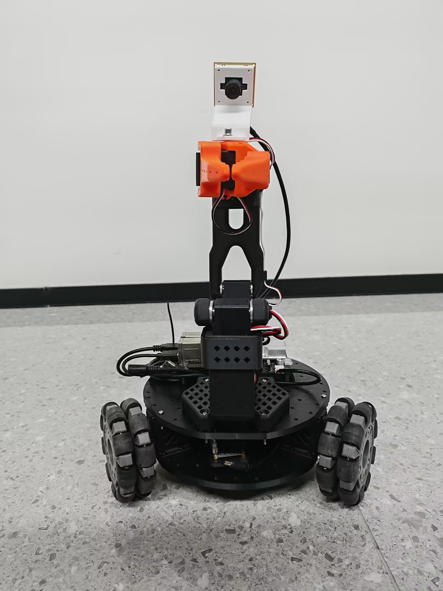
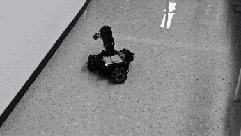

# LeKiwi_A1 —— 移动机械臂机器人（基于 LeRobot）

> LeKiwi 是一个开源的**移动机械臂机器人**：三全向轮差速底盘 + 六自由度机械臂 + 软夹爪，由 9 个 FEETECH STS3215 总线舵机驱动。软件栈基于 [LeRobot](https://github.com/huggingface/lerobot)，主控为**犀牛派 RhinoPi A1**（ARM64 板卡），在 Windows 电脑上遥控操作——可用 SO100 leader 臂拖拽遥控，也可纯键盘遥控。





---

## 目录

- [LeKiwi\_A1 —— 移动机械臂机器人（基于 LeRobot）](#lekiwi_a1--移动机械臂机器人基于-lerobot)
  - [目录](#目录)
  - [本仓库包含什么](#本仓库包含什么)
  - [硬件概览](#硬件概览)
  - [仓库目录结构](#仓库目录结构)
  - [快速开始 —— 三个阶段](#快速开始--三个阶段)
    - [T1 · 板卡端：搭建 host 环境](#t1--板卡端搭建-host-环境)
    - [T2 · 电脑端：环境准备 + 键盘遥控](#t2--电脑端环境准备--键盘遥控)
    - [T3 · 接 leader 臂：校准、零点对齐、拖臂遥操作](#t3--接-leader-臂校准零点对齐拖臂遥操作)
  - [日常命令速查](#日常命令速查)
  - [关掉之后怎么再启动](#关掉之后怎么再启动)
  - [配置项（config/env）](#配置项configenv)
  - [排障](#排障)
  - [实测版本与已知限制](#实测版本与已知限制)
  - [许可证](#许可证)

---

## 本仓库包含什么

本仓库把搭建并运行一台 LeKiwi 机器人所需的全部资料放在一起：

| 类别 | 内容 |
| --- | --- |
| **硬件** | [物料清单 BOM](BOM.md)、[3D 打印件](3D_Printing_Models/)、[装配步骤](Assembly_Steps_and_Structure_Diagram/Assembly_Steps.md)、[接线图](Wiring_Diagram/Wiring_diagram.png)、[舵机 ID 设置](Set_Servo_ID/Set_Servo_ID.md)、关节命名对照（[URDF_JOINT_NAMES.md](URDF_JOINT_NAMES.md)） |
| **软件** | 板卡 host 与电脑端遥控的部署/遥操作脚本（详见 [Code_Resources/](Code_Resources/README_zh.md)） |

> 软件部分（[`Code_Resources/`](Code_Resources/README_zh.md)）衍生自上游
> [`lekiwi-Rhinopi-A1`](https://github.com/XIZAINB/lekiwi-Rhinopi-A1) 部署仓库：一条命令完成环境搭建、
> host 启停、校准与零点对齐辅助、纯键盘遥操作。
> 它**不是 fork**，也没有改动 lerobot 源码——`upstream/lerobot-main/` 只是固定 commit 的只读参考快照。

---

## 硬件概览

- **主控**：犀牛派 RhinoPi A1（阿加犀 APLUX，ARM64 / AidLux 或 Ubuntu 24.04.3）—— 运行 lerobot host。
- **底盘**：3 个 4 英寸（100 mm）全向轮，每个轮由一台 STS3215 舵机驱动（ID **7~9**）。
- **机械臂**：六自由度 + 软夹爪，6 个 STS3215 舵机（ID **1~6**）+ 2 块串口舵机驱动板（12 V 外供电）。
- **供电**：2 块 12 V 5 A 锂电池（一块给底盘和机械臂，一块给犀牛派 A1；无需降压稳压器）。
- **感知**：USB 腕部摄像头（可选，默认关闭）、SO100 leader 臂用于拖拽遥操作。
- **控制端**：Windows 10/11 电脑（PowerShell 5.1）—— 遥控客户端。

完整物料与购买链接见 [BOM.md](BOM.md)；3D 打印件见 [3D_Printing_Models/](3D_Printing_Models/)；
详细装配见 [Assembly_Steps_and_Structure_Diagram/Assembly_Steps.md](Assembly_Steps_and_Structure_Diagram/Assembly_Steps.md)。

> **使用前必须先设置舵机 ID**（机械臂 1~6 号由底座到夹爪；底盘 7~9 号逆时针）。
> 操作步骤见 [Set_Servo_ID/Set_Servo_ID.md](Set_Servo_ID/Set_Servo_ID.md)（使用飞特 FTServo Debug 工具）。

---

## 仓库目录结构

```
LeKiwi_A1/
├── README.md                          # 快速开始指南（英文）
├── README_zh.md                       # 本中文版
├── BOM.md                             # 物料清单（含购买链接）
├── URDF_JOINT_NAMES.md                # LeRobot 与 URDF 关节命名对照
├── cover1.jpg / cover2.jpg            # 项目封面图
├── lekiwi-demo.gif                    # 演示动图（README 顶部）
├── Demonstration.mp4                  # 成品演示视频
│
├── 3D_Printing_Models/                # 3D 打印 STL 文件
│   ├── Arm.stl / Claw.stl             # 机械臂与软夹爪零件
│   ├── base_plate_layer1/2.stl        # 底盘（上下底板）
│   ├── drive_motor_mount(_v2).stl     # 轮驱动电机座
│   ├── Wheel_Connector.stl / servo_wheel_hub.stl
│   ├── base_camera_mount.stl / wrist_camera_mount.stl
│   ├── jetson_holder.stl / pi_case_top|bottom.stl
│   ├── battery_mount(_eu).stl / servo_controller_mount.stl
│   └── modified_base_arm.stl
│
├── Assembly_Steps_and_Structure_Diagram/
│   ├── Assembly_Steps.md              # 分步装配教程（中英双语）
│   ├── arm_disassembly.mp4            # 结构拆分演示视频
│   └── Images/                        # CAD 模型与装配实拍
│
├── Wiring_Diagram/
│   ├── Wiring_diagram.png             # 完整接线图
│   └── Wiring_diagram.psd             # 可编辑源文件
│
├── Set_Servo_ID/
│   ├── Set_Servo_ID.md                # 舵机 ID 设置教程
│   └── Toolkit_FD1.9.8.5.zip          # 飞特 FTServo Debug 调试工具
│
├── images_materials/                  # 物料与硬件实拍图
│
└── Code_Resources/                    # 软件：部署与遥操作
    ├── README.md (README_zh.md)       # 软件完整部署指南
    ├── LICENSE                        # Apache-2.0
    ├── config/
    │   ├── env.example                # 配置模板（bootstrap 会复制成 env）
    │   └── env                        # 本机配置（不入库）—— 唯一需要改的文件
    ├── scripts/
    │   ├── a1_bootstrap.sh            # 板端：apt → uv → clone lerobot → sync → 瘦身 → 自检
    │   ├── a1_slim_venv.sh            # 板端：venv 瘦身（CUDA torch → CPU torch）
    │   ├── a1_detect.sh               # 板端：探测串口 / 相机
    │   ├── a1_calibrate.sh/.py        # 板端：follower 校准引导
    │   ├── a1_host.sh                 # 板端：start / stop / status / log / release-torque
    │   ├── a1_host.py                 # 板端：host 启动器（读取 config/env）
    │   ├── win_bootstrap.ps1          # 电脑端：环境准备 + COM 探测 + 自检
    │   ├── win_calibrate.ps1          # 电脑端：leader 校准引导
    │   ├── teleop.ps1                 # 电脑端：遥操作入口（-Keyboard / -Rerun）
    │   ├── zero_align.ps1             # 电脑端：一条命令零点对齐
    │   ├── teleoperate.py             # 上游衍生：遥操作客户端
    │   ├── teleoperate_keyboard_only.py  # 纯键盘遥操作
    │   ├── align_leader_to_follower.py   # 零点对齐算法
    │   ├── measure_offset_once.py        # 只读测角偏差
    │   ├── release_torque.py             # 释放舵机扭矩
    │   └── _env.py / _env.ps1            # config/env 读取器（sh/py/ps 共用）
    ├── docs/
    │   └── troubleshooting.md         # 20+ 条实测踩坑表（板端/连接/校准/维护）
    └── upstream/
        └── lerobot-main/              # lerobot 源码快照（只读参考，不参与运行）
```

---

## 快速开始 —— 三个阶段

一块新板卡 + 一台新电脑，`git clone` 之后：

| 阶段 | 做什么 | 命令 |
| --- | --- | --- |
| **T1** | 板卡环境 + 启动 host | `a1_bootstrap.sh` → `a1_host.sh start` |
| **T2** | 电脑环境 + 键盘遥控底盘 | `win_bootstrap.ps1` → `teleop.ps1 -Keyboard` |
| **T3** | 接 leader 臂，校准 + 零点对齐后拖臂遥操作 | `win_calibrate.ps1` → `zero_align.ps1` → `teleop.ps1` |

### T1 · 板卡端：搭建 host 环境

```bash
ssh <BOARD_USER>@<BOARD_IP>

git clone https://github.com/XIZAINB/lekiwi-Rhinopi-A1.git ~/LeKiwi_A1
cd ~/LeKiwi_A1

# 一次性环境准备（可重复执行）：apt 依赖 → uv → clone lerobot@commit → uv sync → 瘦身 → 自检
sh Code_Resources/scripts/a1_bootstrap.sh
```

脚本会自动生成 `Code_Resources/config/env`（从 `env.example` 复制）。**你只需改这一个文件**：

```bash
sh Code_Resources/scripts/a1_detect.sh      # 获取 CAMERA_WRIST 建议值（留空 = 不启用相机）
vi Code_Resources/config/env                # 关键项：CAMERA_WRIST
```

> 脚本会自动做「瘦身」：CUDA 版 torch → CPU 版，清掉 `nvidia`/`cuda`/`triton`
>（venv 从约 4.7 GB 降到约 848 MB）。跳过瘦身：`SLIM_VENV=0`。

第一次必须先校准 follower 臂（交互式——按提示摆臂并按回车）：

```bash
sh Code_Resources/scripts/a1_calibrate.sh                # 无校准文件才会进入摆位流程
sh Code_Resources/scripts/a1_calibrate.sh --recalibrate  # 强制重新校准
```

启动 host：

```bash
sh Code_Resources/scripts/a1_host.sh start     # 后台启动
sh Code_Resources/scripts/a1_host.sh status    # 进程 + 日志尾部
sh Code_Resources/scripts/a1_host.sh log       # tail -f
sh Code_Resources/scripts/a1_host.sh stop      # 停止（扭矩保持）
```

看到 `[ok] host 就绪（ZMQ 端口 5555 已监听）` 即成功。`stop` 后想手动摆臂：`sh Code_Resources/scripts/a1_host.sh release-torque`。

> **先给底盘电池上电！** 舵机与轮子由底盘电池供电，USB 不给舵机供电。
> 未上电时 host 会报 `Missing motor IDs: 1~9`。

### T2 · 电脑端：环境准备 + 键盘遥控

```powershell
git clone https://github.com/XIZAINB/lekiwi-Rhinopi-A1.git C:\LeKiwi_A1
cd C:\LeKiwi_A1

# 一次性环境准备：uv → clone lerobot → uv sync → 探测 COM 口 → 自检
powershell -ExecutionPolicy Bypass -File Code_Resources\scripts\win_bootstrap.ps1
```

编辑 `Code_Resources\config\env`，填入板卡信息：

```ini
BOARD_IP=192.168.1.100
BOARD_USER=aidlux
```

板卡与电脑需要**在同一网段**（路由器不要开 AP 隔离）。板卡 IP 用 `hostname -I` 查。

先纯键盘验证底盘与相机（不需要 leader 臂）：

```powershell
powershell -ExecutionPolicy Bypass -File Code_Resources\scripts\teleop.ps1 -Keyboard
```

| 按键 | 动作 |
| --- | --- |
| `w` / `s` | 前进 / 后退 |
| `a` / `d` | 左移 / 右移 |
| `z` / `x` | 原地左转 / 右转 |
| `r` / `f` | 加速 / 减速（0.1 / 0.2 / 0.3 m/s） |
| `Ctrl+C` | 退出（底盘由 host 看门狗 0.5 s 内自动停） |

> 想同时看腕部相机画面，加 `-Rerun`：`teleop.ps1 -Keyboard -Rerun`。

### T3 · 接 leader 臂：校准、零点对齐、拖臂遥操作

```powershell
# 1) leader 串口（换 USB 口会变，务必确认）
powershell -ExecutionPolicy Bypass -File Code_Resources\scripts\win_bootstrap.ps1 -DetectOnly

# 2) leader 校准（必须手按回车，脚本会提示）
powershell -ExecutionPolicy Bypass -File Code_Resources\scripts\win_calibrate.ps1

# 3) 零点对齐：松扭矩 → 两臂摆同一姿势 → 一条命令完成测差/对齐/复测
powershell -ExecutionPolicy Bypass -File Code_Resources\scripts\zero_align.ps1

# 4) 遥操作 —— 拖 leader 臂控制 follower
powershell -ExecutionPolicy Bypass -File Code_Resources\scripts\teleop.ps1
```

> **任意一侧重新校准过，都必须重跑 `zero_align.ps1`**，否则遥操作会出现固定角度偏差。

---

## 日常命令速查

| 目的 | 命令 |
| --- | --- |
| 启动 host | `ssh aidlux@<IP> "cd ~/LeKiwi_A1 && sh Code_Resources/scripts/a1_host.sh start"` |
| 停止 host | `ssh aidlux@<IP> "cd ~/LeKiwi_A1 && sh Code_Resources/scripts/a1_host.sh stop"` |
| 看日志 | `ssh aidlux@<IP> "tail -f ~/host.log"` |
| 释放扭矩 | `ssh aidlux@<IP> "cd ~/LeKiwi_A1 && sh Code_Resources/scripts/a1_host.sh release-torque"` |
| 键盘遥控 | `powershell -ExecutionPolicy Bypass -File Code_Resources\scripts\teleop.ps1 -Keyboard -Rerun` |
| leader 遥控 | `powershell -ExecutionPolicy Bypass -File Code_Resources\scripts\teleop.ps1` |
| 重新对齐 | `powershell -ExecutionPolicy Bypass -File Code_Resources\scripts\zero_align.ps1` |
| 重启 host（先停再起） | `ssh aidlux@<IP> "cd ~/LeKiwi_A1 && sh Code_Resources/scripts/a1_host.sh stop && sh Code_Resources/scripts/a1_host.sh start"` |

---

## 关掉之后怎么再启动

环境准备（bootstrap）与校准**只做一次**。之后每次重启，**顺序不能反：先板卡 host，后电脑遥操作**。

**情形 A · 只关了电脑端** —— host 还在板卡上跑，直接重连 `teleop.ps1` 即可。

**情形 B · host 也停了**（跑过 stop / 板卡重启过 / 1 小时存活时间到了）：

```powershell
ssh aidlux@192.168.112.249 "cd ~/LeKiwi_A1 && sh Code_Resources/scripts/a1_host.sh start"
```

**情形 C · 板卡断电 / IP 变了（DHCP）** —— 先查 IP，再改电脑端 `Code_Resources\config\env` 里的 `BOARD_IP`：

```bash
ssh aidlux@<IP> "hostname -I"
```

```powershell
Test-NetConnection <BOARD_IP> -Port 5555
```

关掉再开，哪些要重做：

- **底盘电池上电** —— USB 不给舵机供电。
- **`a1_host.sh start`** —— host 不是 systemd 服务，不随开机自启。
- 校准 / 零点对齐 / 配置 —— **不用**重做，除非拆装过舵机或改了舵机 ID。

建议的关闭顺序：电脑端 `Ctrl+C` → （可选）板端停 host → 断底盘电池。

---

## 配置项（config/env）

一份文件，shell / Python / PowerShell 共用。配好之后一般只需要改它。

| 键 | 默认 | 说明 |
| --- | --- | --- |
| `BOARD_IP` | — | 板卡 IP |
| `BOARD_USER` | `aidlux` | SSH 用户 |
| `LEROBOT_COMMIT` | `53feaef` | 固定的 lerobot commit（两端必须一致） |
| `ROBOT_ID` | `my_kiwi` | follower 校准 ID（板端） |
| `ROBOT_PORT` | `/dev/ttyACM0` | 舵机总线串口（板端） |
| `CAMERA_WRIST` | 空 | 腕部相机；**留空 = 不启用相机** |
| `ZMQ_CMD_PORT` / `ZMQ_OBS_PORT` | `5555 / 5556` | ZMQ 端口 |
| `CONNECTION_TIME_S` | `3600` | host 存活时间（默认 30 s 会自动退出） |
| `LEADER_PORT` | `COM11` | leader 串口（电脑端） |
| `LEADER_ID` | `my_awesome_leader_arm` | leader 校准 ID |
| `SLIM_VENV` | `1` | 板端 venv 瘦身；`0` 关闭 |
| `SHOW_RERUN` | `0` | `1` = 默认弹 rerun 可视化窗口 |
| `ARM_HOLD_*` | — | 纯键盘模式机械臂滤波（死区 / EMA / 坏包拒绝） |

> 想临时覆盖某个值：直接设同名环境变量即可，
> 如 `ROBOT_PORT=/dev/ttyACM1 sh Code_Resources/scripts/a1_host.sh start`。

---

## 排障

先看 [`Code_Resources/docs/troubleshooting.md`](Code_Resources/docs/troubleshooting.md) —— 四大类
（板端 host / 电脑端连接 / 校准与零点对齐 / 维护）共 20+ 条实测踩坑。最常见几条：

- **连不上 host**（`Timeout waiting for LeKiwi Host to connect`）：host 没起 / IP 变了 / 不同网段 / 路由器开了 AP 隔离。用 `Test-NetConnection <IP> -Port 5555` 检查。
- **`Missing motor IDs: 1~9`**：底盘电池没上电。
- **host 30 秒后自己退出**：`CONNECTION_TIME_S` 必须是 3600（上游默认 30）。
- **相机能开但读不到帧**：板载 ISP 管理节点占了 `video0`；跑 `a1_detect.sh`，用 `/dev/v4l/by-id/` 别名回填 `CAMERA_WRIST`。
- **遥操作出现固定角度偏差**：任何一侧重新校准后重跑 `zero_align.ps1`。

---

## 实测版本与已知限制

实测环境（2026-10-30）：犀牛派 RhinoPi A1（Ubuntu 24.04.3 / aarch64）+ Windows 11 + SO100 leader 臂。

| 组件 | 版本 |
| --- | --- |
| lerobot | commit `53feaef` |
| Python（板端） | 3.12.3（由 `uv` 管理） |
| torch（板端） | `2.8.0+cpu`（瘦身后） |
| 板端 venv 体积 | 848 MB（瘦身前 4.7 GB） |
| 零点对齐 | 对齐前最大偏差 12.48° → 对齐后**残差 0.13°** |

已知限制：不含数据集录制/训练/评估（上游 lerobot 已覆盖，本仓库只做到遥操作）；只验证过腕部单相机；
只实测过 Windows 控制端；校准文件是每台机器独有的，**不会随仓库分发**。

---

## 许可证

Apache-2.0（见 [Code_Resources/LICENSE](Code_Resources/LICENSE)）。lerobot 为 Apache-2.0；硬件设计属于 SIGRobotics-UIUC/LeKiwi。

英文版：[README.md](README.md)
